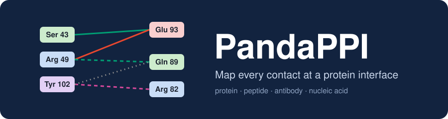
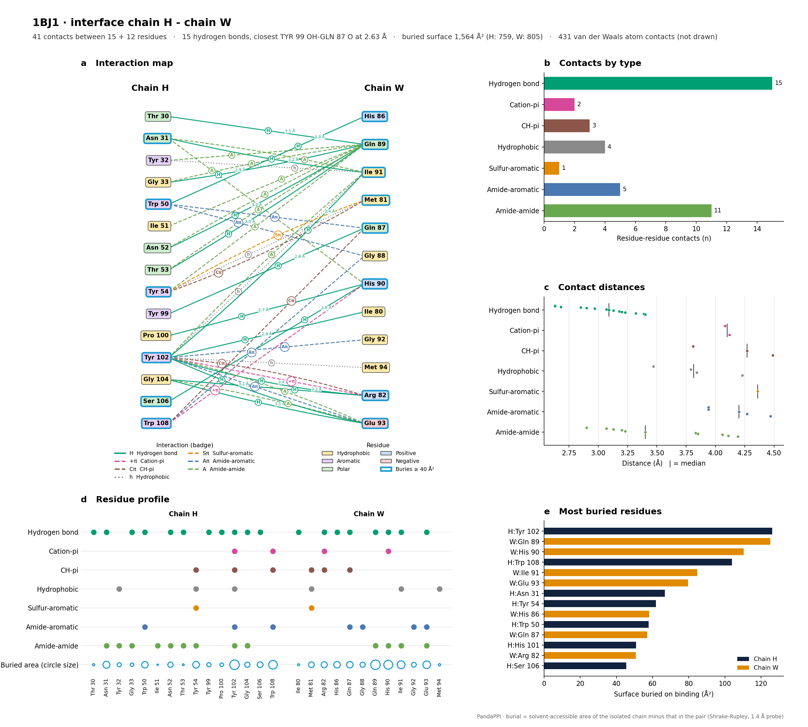
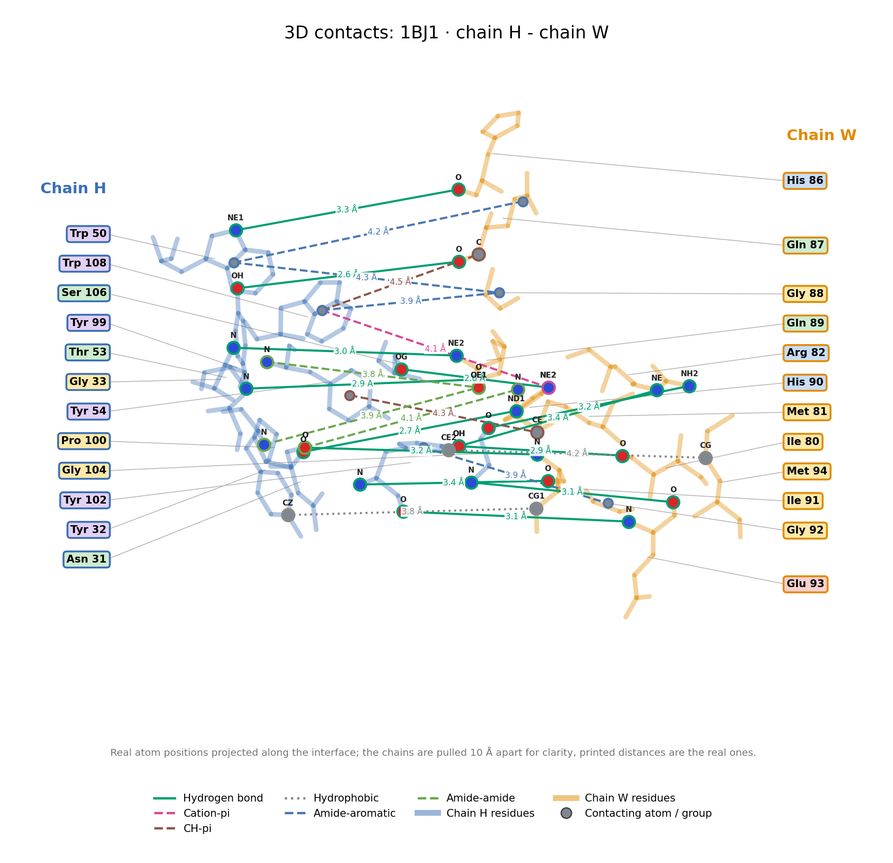
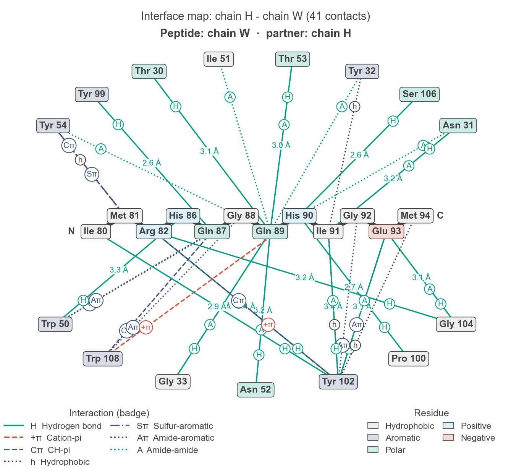
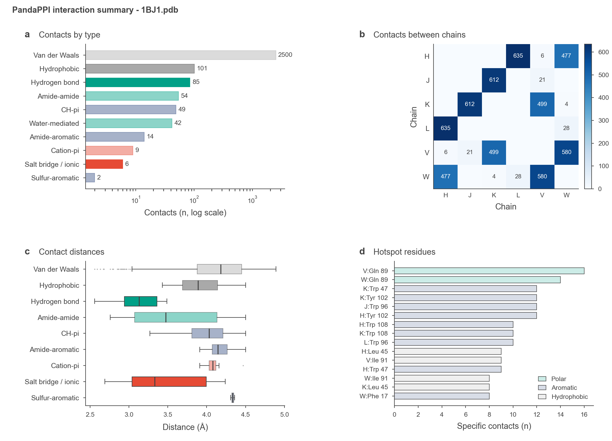

<p align="center">
  
</p>

<p align="center">
  <a href="https://pypi.org/project/pandappi/"></a>
  <a href="https://github.com/pritampanda15/PandaPPI/actions/workflows/ci.yml"></a>
  
  <a href="https://github.com/pritampanda15/PandaPPI/blob/main/LICENSE"></a>
  <a href="https://github.com/pritampanda15/PandaPPI/commits/main"></a>
  <a href="https://github.com/pritampanda15/PandaPPI/issues"></a>
  <a href="https://github.com/pritampanda15/PandaPPI/stargazers"></a>
  <a href="https://github.com/pritampanda15/PandaPPI/network/members"></a>
</p>

**PandaPPI** reads a PDB file and maps the non-covalent contacts between its chains: protein-protein, antibody-antigen, protein-peptide and protein-nucleic acid. One command gives you publication-style figures and tables for every interface in the structure.

```bash
pandappi complex.pdb --all-outputs -o results
```

<p align="center">
  <a href="https://github.com/pritampanda15/PandaPPI/blob/main/docs/pandappi_demo.mp4"></a>
</p>
<p align="center"><sub>30-second demo. Click it for the <a href="https://github.com/pritampanda15/PandaPPI/blob/main/docs/pandappi_demo.mp4">full-resolution video with sound</a>.</sub></p>

## Contents

- [What you get](#what-you-get)
- [Install](#install)
- [Quick start](#quick-start)
- [Outputs](#outputs)
- [Python API](#python-api)
- [Interaction types](#interaction-types)
- [Command-line reference](#command-line-reference)
- [Citation](#citation)

## What you get

### Interface report

One page per chain pair. Panel **a** is the residue contact map, with a badge on each line for the interaction type. Panels **b** and **c** count the contacts and show their distances. Panel **d** shows which residue makes which kind of contact, and panel **e** ranks residues by the surface they bury on binding. The header gives the buried surface area of the interface and its closest hydrogen bond.

<p align="center">
  
</p>

### 3D contacts view

The same interface at atom level: side chains drawn from their real coordinates, the contacting atoms named, and each contact labelled with its true distance.

<p align="center">
  
</p>

### Peptides and oligonucleotides

When one chain of a pair has 30 residues or fewer, the map switches to a radial layout: the short chain is drawn as a backbone in the centre, with its partner's residues around it.

<p align="center">
  
</p>

<sub>Example: a 16-residue antigen loop cut from 1BJ1 and treated as a peptide. A DNA strand drawn the same way is in <a href="https://raw.githubusercontent.com/pritampanda15/PandaPPI/main/test/protein-nucleicacid/protein_DNA_interface_A-N.png">the 3L1P example</a>.</sub>

### Summary dashboard

The whole structure at a glance: contacts by type, which chains touch, distance distributions and hotspot residues.

<p align="center">
  
</p>

### Publication-ready figures

Every figure follows Nature figure conventions, so it can go into a manuscript without redrawing:

- 183 mm wide (double column), with 5-7 pt Arial/Helvetica text and 8 pt bold lowercase panel letters.
- The NPG colour palette, with colour meaning the same thing in every panel: teal for polar contacts, red for charged, navy for aromatic, charcoal for apolar. Line style and the badge letter separate the types within a colour.
- Each figure is written twice: a 300 dpi PNG and a vector PDF with editable text, under the same name.

## Install

PandaPPI needs Python 3.9 or newer.

```bash
pip install pandappi
```

For the development version, install from GitHub:

```bash
pip install git+https://github.com/pritampanda15/PandaPPI.git
```

Dependencies (installed automatically): Biopython, NumPy, pandas, Matplotlib, NetworkX and py3Dmol.

## Quick start

Everything for an antibody-antigen complex, restricted to six chains:

```bash
pandappi 1BJ1.pdb --chains L H V W J K --all-outputs -o antigen_antibody
```

Only the interface reports and the 3D contacts views:

```bash
pandappi complex.pdb --interface-report --contacts-3d -o results
```

Only hydrogen bonds and salt bridges, as a table:

```bash
pandappi complex.pdb --hydrogen-bonds --salt-bridges --report -o polar
```

The input files for these examples, and every output they produce, are in [`test/`](https://github.com/pritampanda15/PandaPPI/tree/main/test).

## Outputs

`<prefix>` is whatever you pass to `-o` (default `pandappi`). Each `.png` figure below also comes as a vector `.pdf` with the same name.

| Flag | What it writes | File |
|------|----------------|------|
| `--interface-report` | Interface report per chain pair | `<prefix>_interface_<A>-<B>.png` |
| `--contacts-3d` | Atom-level contacts per chain pair | `<prefix>_contacts3d_<A>-<B>.png` |
| `--map` | Contact map only, per chain pair | `<prefix>_map_<A>-<B>.png` |
| `--dashboard` | Summary dashboard | `<prefix>_dashboard.png` |
| `--html-report` | One self-contained HTML page with all figures and tables, plus the text report, both CSVs, the dashboard, interface reports and 3D contacts views | `<prefix>_report.html`, `<prefix>_report.txt` |
| `--report` | Every interaction, one row each | `<prefix>_report.csv` |
| `--residue-summary` | Interaction counts per residue | `<prefix>_residue_summary.csv` |
| `--statistics` | Totals and average distances | `<prefix>_stats.txt` |
| `--network` | Residue interaction network | `<prefix>_network.png`, `<prefix>_network.gml` |
| `--3d-plot` | Interactive 3D viewer | `<prefix>_3d.html` |
| `--export-vis` | Scripts that rebuild the interface in PyMOL, ChimeraX, Chimera, VMD and Mol* | `<prefix>.pml`, `.cxc`, `.cmd`, `.tcl`, `.molj` |
| `--all-outputs` | All of the above | |

The interaction table has one row per contact:

| Interaction_Type | Chain1 | Residue1 | Atom1 | Chain2 | Residue2 | Atom2 | Distance_Å |
|---|---|---|---|---|---|---|---|
| Hydrogen bond | H | TYR 99 | OH | W | GLN 87 | O | 2.63 |

## Python API

```python
from pandappi import PandaPPI

analyzer = PandaPPI("1BJ1.pdb", chains=["H", "L", "W"])
analyzer.map_interactions()

# every figure and table in one call
files = analyzer.generate_full_report("results")

# or one piece at a time
table = analyzer.generate_report("results_report.csv")    # pandas DataFrame
analyzer.create_interface_reports("results")              # one PNG per chain pair
analyzer.create_contact_views("results")                  # atom-level 3D contacts
analyzer.create_interaction_maps("results")               # contact maps only
analyzer.create_dashboard("results_dashboard.png")
analyzer.create_interaction_network("results_network.png")
analyzer.visualize_3d("results_3d.html")
```

**Find the epitope.** The antigen residues (chain W) that touch the antibody (chains H and L):

```python
antibody, antigen = ["H", "L"], "W"
on_right = table[table.Chain1.isin(antibody) & (table.Chain2 == antigen)].Residue2
on_left = table[table.Chain2.isin(antibody) & (table.Chain1 == antigen)].Residue1
epitope = sorted(set(on_right) | set(on_left), key=lambda r: int(r.split()[1]))
print(epitope)
```

**Buried surface area.** How much surface each residue loses when two chains bind, in Ų:

```python
buried = analyzer.buried_surface("H", "W")      # {("H", "TYR 102"): 126.3, ...}
print(f"Interface buries {sum(buried.values()):.0f} Ų")
top = sorted(buried.items(), key=lambda kv: kv[1], reverse=True)[:5]
```

**Hotspot residues.** The residues that make the most contacts:

```python
from pandappi.reports.generator import create_residue_summary

hotspots = create_residue_summary(analyzer.interactions)
print(hotspots.head(10))
```

## Interaction types

PandaPPI detects 16 kinds of contact. With the default settings the cutoffs are:

| Interaction | Flag | Cutoff |
|-------------|------|--------|
| Hydrogen bond | `--hydrogen-bonds` | 3.5 Å donor-acceptor |
| Disulfide bridge | `--disulfide` | 2.2 Å S-S |
| Water-mediated | `--water-mediated` | 3.5 Å to the bridging water |
| Metal coordination | `--metal-coordination` | 3.0 Å to the metal |
| Van der Waals | `--van-der-waals` | from atomic radii |
| Salt bridge | `--salt-bridges` | `--distance-cutoff` |
| Ionic | `--ionic` | `--distance-cutoff` |
| Hydrophobic | `--hydrophobic` | `--distance-cutoff` |
| Pi-pi stacking | `--pi-stacking` | `--distance-cutoff` |
| Cation-pi | `--pi-cation`, `--cation-pi` | `--distance-cutoff` |
| CH-pi | `--ch-pi` | `--distance-cutoff` |
| Sulfur-aromatic | `--sulfur-aromatic` | `--distance-cutoff` |
| Amide-aromatic | `--amide-aromatic` | `--distance-cutoff` |
| Amide-amide | `--amide-amide` | `--distance-cutoff` |
| Halogen bond | `--halogen-bonds` | `--distance-cutoff` |

`--distance-cutoff` defaults to 4.5 Å and applies to every row that names it. With no interaction flags, all types are mapped; `--standard-only` keeps hydrogen bonds, ionic, hydrophobic, pi-pi stacking, cation-pi and salt bridges.

How the numbers are counted:

- Only contacts between different chains are reported, unless you pass `--include-intrachain`.
- In the report table, figures and HTML page, each contact is counted once. `<prefix>_stats.txt` reports the raw detector output, where a contact can appear twice.
- Van der Waals contacts are in the CSV but are left out of the maps and the HTML table, because there are thousands of them.
- Buried surface area is the solvent-accessible area of each chain on its own minus its area in the pair (Shrake-Rupley, 1.4 Å probe). Waters and ligands are ignored.

## Command-line reference

```
usage: pandappi [-h] [--chains CHAINS [CHAINS ...]] [--output OUTPUT] [--all-outputs] [--map]
               [--interface-report] [--contacts-3d] [--dashboard] [--html-report] [--report]
               [--residue-summary] [--statistics] [--network] [--3d-plot] [--export-vis]
               [--distance-cutoff DISTANCE_CUTOFF] [--include-intrachain] [--all-interactions]
               [--standard-only] [--hydrogen-bonds] [--ionic] [--hydrophobic] [--pi-stacking]
               [--pi-cation] [--salt-bridges] [--cation-pi] [--ch-pi] [--disulfide]
               [--sulfur-aromatic] [--water-mediated] [--metal-coordination] [--halogen-bonds]
               [--amide-aromatic] [--van-der-waals] [--amide-amide]
               pdb_file

PandaPPI: Comprehensive Protein Interaction Mapper

positional arguments:
  pdb_file              Path to PDB file

options:
  -h, --help            show this help message and exit
  --chains CHAINS [CHAINS ...]
                        Chains to analyze (e.g., A B)
  --output, -o OUTPUT   Output file prefix (default: pandappi)
  --all-outputs         Generate everything: reports, interface maps, dashboard, network, 3D view,
                        viewer scripts
  --distance-cutoff DISTANCE_CUTOFF
                        Distance cutoff for interaction detection (default: 4.5Å)
  --include-intrachain  Include intra-chain interactions

Outputs:
  --map                 2D interface map (PNG) for every chain pair
  --interface-report    Multi-panel report figure per chain pair: map, contact types, distances,
                        residue profile, buried surface area
  --contacts-3d         Atom-level 3D contacts figure per chain pair (side chains, contacting
                        atoms, distances)
  --dashboard           Summary dashboard figure (PNG)
  --html-report         Full report: HTML page, text report, CSVs, dashboard and interface reports
  --report              Interaction table (CSV)
  --residue-summary     Per-residue interaction counts (CSV)
  --statistics          Print interaction statistics and save them as text
  --network             Residue interaction network (PNG + GML)
  --3d-plot             Interactive 3D visualization (HTML)
  --export-vis          Export scripts for PyMOL (.pml), ChimeraX (.cxc), Chimera (.cmd), VMD
                        (.tcl) and Mol* (.molj)

Interaction Types (default: all):
  --all-interactions    Map all interaction types (default)
  --standard-only       Only standard interactions (H-bonds, ionic, hydrophobic, pi-stacking, pi-
                        cation, salt bridges)
  --hydrogen-bonds      Map hydrogen bonds
  --ionic               Map ionic interactions
  --hydrophobic         Map hydrophobic interactions
  --pi-stacking         Map pi-pi stacking interactions
  --pi-cation           Map pi-cation interactions
  --salt-bridges        Map salt bridges
  --cation-pi           Map cation-pi interactions
  --ch-pi               Map CH-pi interactions
  --disulfide           Map disulfide bridges
  --sulfur-aromatic     Map sulfur-aromatic interactions
  --water-mediated      Map water-mediated interactions
  --metal-coordination  Map metal-coordinated bonds
  --halogen-bonds       Map halogen bonds
  --amide-aromatic      Map amide-aromatic interactions
  --van-der-waals       Map van der Waals interactions
  --amide-amide         Map amide-amide hydrogen bonds
```

## Citation

If you use PandaPPI in your research, please cite:

```
Pritam Kumar Panda. PandaPPI: mapping and visualizing molecular interactions at
protein-protein, protein-nucleic acid and antigen-antibody interfaces.
GitHub repository, https://github.com/pritampanda15/PandaPPI
```

## License

MIT. See [LICENSE](https://github.com/pritampanda15/PandaPPI/blob/main/LICENSE).

## Contributing

Bug reports and pull requests are welcome on the [issue tracker](https://github.com/pritampanda15/PandaPPI/issues).
