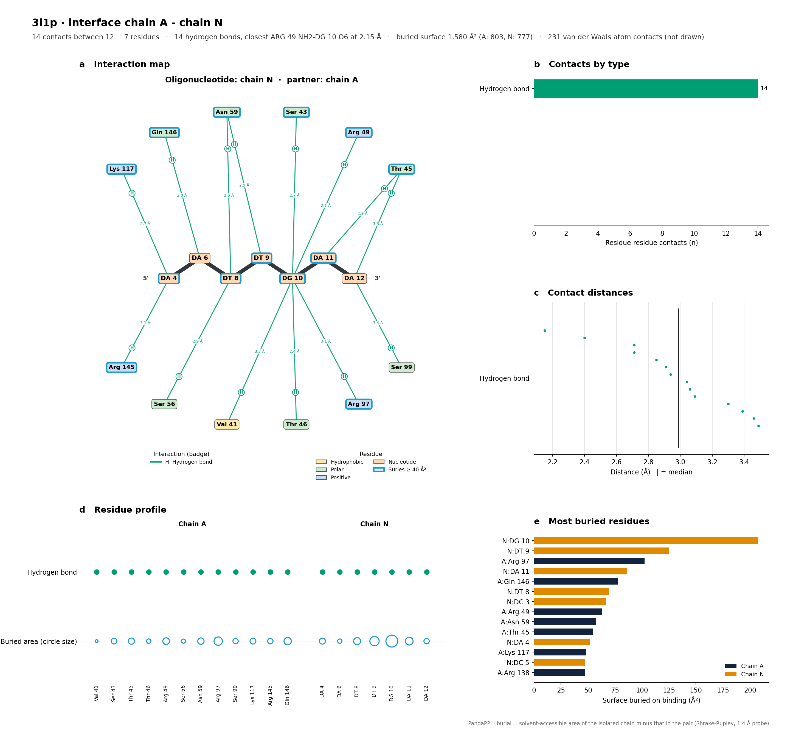
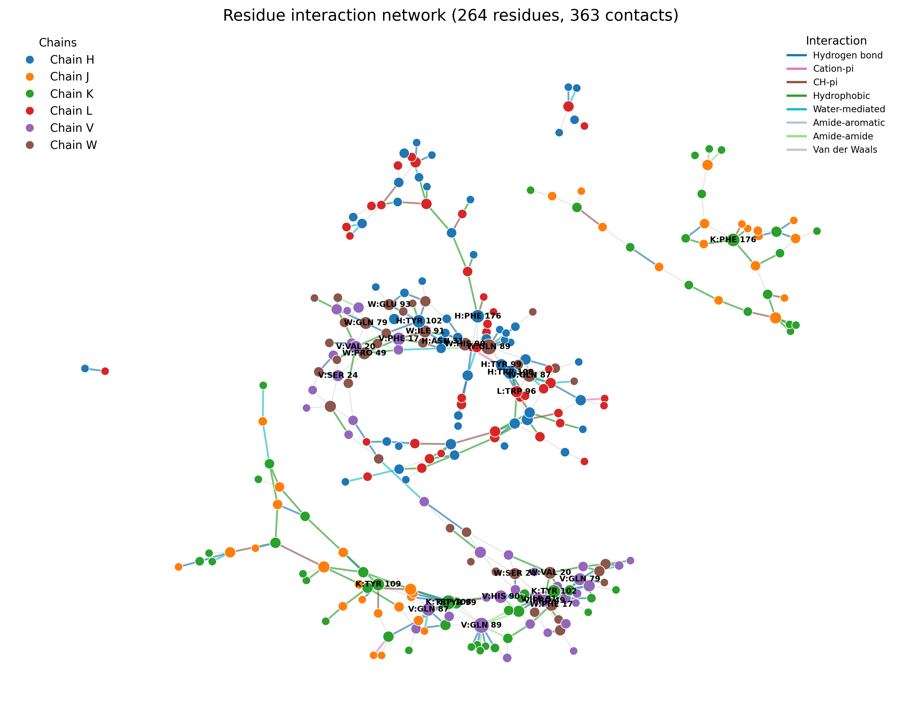

# PandaPPI

A comprehensive Python application for mapping and visualizing molecular interactions at protein/nucleic acid interfaces. A tool for mapping protein-protein, protein-nucleic acid, and antigen-antibody interactions.

<p align="center">
   
</p>
<p align="center">
  <a href="https://pypi.org/project/pandappi/">
    
  </a>
  <a href="https://github.com/pritampanda15/PandaPPI/blob/main/LICENSE">
    
  </a>
  <a href="https://github.com/pritampanda15/PandaPPI/stargazers">
    
  </a>
  <a href="https://github.com/pritampanda15/PandaPPI/issues">
    
  </a>
  <a href="https://github.com/pritampanda15/PandaPPI/network/members">
    
  </a>
  <a href="https://libraries.io/pypi/pandappi">
    
  </a>
  <!-- Custom Project Badge -->
  <a href="https://github.com/pritampanda15/PandaPPI">
    
  </a>
  <!-- Custom Install Count (Mocked) -->
    <a href="https://pepy.tech/project/pandappi">
    
  </a>

</a>

  </a>
</p>

## What you get

One command turns a PDB file into a full interface analysis:

```bash
pandappi 1BJ1.pdb --chains L H V W J K --all-outputs -o antigen_antibody
```

| Output | File |
|--------|------|
| Interface report per chain pair (map, contact types, distances, residue profile, buried surface) | `<prefix>_interface_<A>-<B>.png` |
| Atom-level 3D contacts per chain pair | `<prefix>_contacts3d_<A>-<B>.png` |
| Contact map only (`--map`) | `<prefix>_map_<A>-<B>.png` |
| Summary dashboard | `<prefix>_dashboard.png` |
| Self-contained HTML report (figures + tables) | `<prefix>_report.html` |
| Text report | `<prefix>_report.txt` |
| Interaction table / per-residue counts | `<prefix>_report.csv`, `<prefix>_residue_summary.csv` |
| Residue interaction network | `<prefix>_network.png`, `<prefix>_network.gml` |
| Interactive 3D view | `<prefix>_3d.html` |
| PyMOL / Chimera / VMD / Mol* scripts | `<prefix>.pml`, `.cmd`, `.tcl`, `.molj` |

### Interface reports

Every chain pair gets a one-page figure: (a) residue contact map with a badge per interaction type, (b) contacts by type, (c) contact distances, (d) which residue makes which kind of contact, and (e) the residues that bury the most surface on binding. The header gives contact counts, the closest hydrogen bond and the buried surface area of the interface.

<p align="center">
  
</p>

### Peptides and oligonucleotides

When one chain of a pair has 30 residues or fewer, the map switches to a PandaMap-style layout: the short chain is drawn as a backbone in the centre and its partner's residues are arranged around it.

<p align="center">
  
</p>

The same layout for a peptide (`--map` output; here a 16-residue antigen loop cut out of 1BJ1 and treated as a peptide bound to the antibody heavy chain):

<p align="center">
  
</p>

### 3D contacts view

The atom-level picture of the same interface: real side-chain geometry projected along the interface, the contacting atoms named, and each contact drawn with its true distance.

<p align="center">
  
</p>

### Summary dashboard

<p align="center">
  
</p>

### Residue interaction network

<p align="center">
  
</p>

Complete example outputs for an antibody-antigen complex, a protein-DNA complex and a protein-DNA-ligand complex are in [`test/`](test/).

### Comprehensive Interaction Mapping

PandaPPI can detect and analyze a comprehensive set of molecular interactions that occur in protein/DNA structures:

**Standard Interactions:**
- **Hydrogen Bonds**: Between hydrogen donors and acceptors (N-H···O, O-H···O, etc.)
- **Ionic Interactions**: Between oppositely charged residues (Arg/Lys/His with Asp/Glu)
- **Hydrophobic Interactions**: Between non-polar side chains
- **Pi-Pi Stacking**: Between aromatic rings (parallel, T-shaped, offset-stacked)
- **Pi-Cation Interactions**: Between aromatic rings and cationic groups
- **Salt Bridges**: Close-range ionic interactions forming "bridges"

**Enhanced Interactions:**
- **Cation-Pi Interactions**: Between cations and aromatic rings
- **CH-Pi Interactions**: Between CH groups and aromatic rings
- **Disulfide Bridges**: Covalent bonds between cysteine residues
- **Sulfur-Aromatic Interactions**: Between sulfur atoms and aromatic rings
- **Water-Mediated Interactions**: Hydrogen bonds bridged by water molecules
- **Metal-Coordinated Bonds**: Interactions mediated by metal ions
- **Halogen Bonds**: Between halogen atoms and Lewis bases
- **Amide-Aromatic Interactions**: Between amide groups and aromatic rings
- **Van der Waals Interactions**: Non-specific attractive forces
- **Amide-Amide Hydrogen Bonds**: Between backbone or side chain amide groups

### Intuitive Visualization

- **Interactive 3D Visualization**: Color-coded display of interactions in the 3D structure
- **Interface Reports**: Contact map, contact types, distances, residue profile and buried surface area for every chain pair
- **3D Contacts View**: Side chains, contacting atoms and true distances for every chain pair
- **Peptide Maps**: PandaMap-style radial diagrams when one partner is a peptide or oligonucleotide
- **Summary Dashboard**: Interaction counts, chain contact matrix, distance distributions, hotspots
- **HTML Report**: One self-contained page with all figures and tables
- **Network Analysis**: Graph representation of interaction networks
- **Detailed Reports**: Comprehensive interaction statistics and measurements

## Installation

```bash
pip install pandappi
```

## Usage

### Command Line Interface
```bash
pandappi -h
usage: pandappi [-h] [--chains CHAINS [CHAINS ...]] [--output OUTPUT] [--all-outputs] [--map]
               [--interface-report] [--contacts-3d] [--dashboard] [--html-report] [--report]
               [--residue-summary] [--statistics] [--network] [--3d-plot] [--export-vis]
               [--distance-cutoff DISTANCE_CUTOFF] [--include-intrachain] [--all-interactions]
               [--standard-only] [--hydrogen-bonds] [--ionic] [--hydrophobic] [--pi-stacking] [--pi-cation]
               [--salt-bridges] [--cation-pi] [--ch-pi] [--disulfide] [--sulfur-aromatic] [--water-mediated]
               [--metal-coordination] [--halogen-bonds] [--amide-aromatic] [--van-der-waals] [--amide-amide]
               pdb_file

PandaPPI: Comprehensive Protein Interaction Mapper

positional arguments:
  pdb_file              Path to PDB file

options:
  -h, --help            show this help message and exit
  --chains CHAINS [CHAINS ...]
                        Chains to analyze (e.g., A B)
  --output, -o OUTPUT   Output file prefix (default: pandappi)
  --all-outputs         Generate everything: reports, interface maps, dashboard, network, 3D view, viewer
                        scripts
  --distance-cutoff DISTANCE_CUTOFF
                        Distance cutoff for interaction detection (default: 4.5Å)
  --include-intrachain  Include intra-chain interactions

Outputs:
  --map                 2D interface map (PNG) for every chain pair
  --interface-report    Multi-panel report figure per chain pair: map, contact types, distances, residue
                        profile, buried surface area
  --contacts-3d         Atom-level 3D contacts figure per chain pair (side chains, contacting atoms,
                        distances)
  --dashboard           Summary dashboard figure (PNG)
  --html-report         Full report: HTML page, text report, CSVs, dashboard and interface reports
  --report              Interaction table (CSV)
  --residue-summary     Per-residue interaction counts (CSV)
  --statistics          Print interaction statistics and save them as text
  --network             Residue interaction network (PNG + GML)
  --3d-plot             Interactive 3D visualization (HTML)
  --export-vis          Export visualization files for PyMOL, Chimera, VMD, and Molstar

Interaction Types (default: all):
  --all-interactions    Map all interaction types (default)
  --standard-only       Only standard interactions (H-bonds, ionic, hydrophobic, pi-stacking, pi-cation,
                        salt bridges)
  --hydrogen-bonds      Map hydrogen bonds
  --ionic               Map ionic interactions
  --hydrophobic         Map hydrophobic interactions
  --pi-stacking         Map pi-pi stacking interactions
  --pi-cation           Map pi-cation interactions
  --salt-bridges        Map salt bridges
  --cation-pi           Map cation-pi interactions
  --ch-pi               Map CH-pi interactions
  --disulfide           Map disulfide bridges
  --sulfur-aromatic     Map sulfur-aromatic interactions
  --water-mediated      Map water-mediated interactions
  --metal-coordination  Map metal-coordinated bonds
  --halogen-bonds       Map halogen bonds
  --amide-aromatic      Map amide-aromatic interactions
  --van-der-waals       Map van der Waals interactions
  --amide-amide         Map amide-amide hydrogen bonds
```

# Full command
```bash
pandappi 4kpy.pdb --chains A B C D E F --all-outputs --output protein-dna-ligand
```
```bash
pandappi 1BJ1.pdb --chains L H V W J K --all-outputs --output antigen_antibody
```

```bash
# Basic usage - map all interactions
pandappi example.pdb

# Analyze specific chains
pandappi example.pdb --chains A B

# Interface reports, contact maps, dashboard and full HTML report
pandappi example.pdb --interface-report
pandappi example.pdb --contacts-3d
pandappi example.pdb --map
pandappi example.pdb --dashboard
pandappi example.pdb --html-report

# Generate 3D visualization
pandappi example.pdb --3d-plot

# Generate detailed report
pandappi example.pdb --report

# Generate interaction network
pandappi example.pdb --network

# Map specific interaction types
pandappi example.pdb --hydrogen-bonds --ionic --salt-bridges

# Map only standard interactions
pandappi example.pdb --standard-only

# Include water-mediated and metal-coordinated interactions
pandappi example.pdb --water-mediated --metal-coordination

# Generate interaction statistics
pandappi example.pdb --statistics

# Specify output file prefix
pandappi example.pdb --3d-plot --report --network --output myresults

# Include intra-chain interactions
pandappi example.pdb --include-intrachain
```

### Python API

```python
from pandappi import PandaPPI

# Initialize with PDB file
analyzer = PandaPPI("example.pdb", chains=["A", "B"])

# Map all interactions
interactions = analyzer.map_interactions()

# Map with custom parameters
interactions = analyzer.map_interactions(
    distance_cutoff=4.5,
    include_intrachain=False
)

# Filter interactions
filtered = analyzer.filter_interactions(
    interaction_types=["hydrogen_bonds", "salt_bridges"],
    chains=["A"],
    distance_range=(2.5, 3.5)
)

# Generate 3D visualization
analyzer.visualize_3d("visualization.html")

# Visualize specific interaction types
analyzer.visualize_3d(
    "hbonds_visualization.html", 
    interaction_types=["hydrogen_bonds", "water_mediated"]
)

# Generate detailed report
report = analyzer.generate_report("report.csv")

# Generate report for specific interaction types
report = analyzer.generate_report(
    "ionic_report.csv",
    interaction_types=["ionic_interactions", "salt_bridges"]
)

# Interface reports and contact maps (one PNG per chain pair), dashboard, and the full report
reports = analyzer.create_interface_reports("myresults")
views = analyzer.create_contact_views("myresults")  # atom-level 3D contacts
maps = analyzer.create_interaction_maps("myresults")
buried = analyzer.buried_surface("A", "B")  # {(chain, residue): Ų buried on binding}
analyzer.create_dashboard("myresults_dashboard.png")
files = analyzer.generate_full_report("myresults")  # HTML + text + CSVs + figures

# Create interaction network (PNG + GML)
graph = analyzer.create_interaction_network("network.png")

# Get interaction statistics
stats = analyzer.get_interaction_statistics()
print(f"Total interactions: {stats['total_interactions']}")
print(f"Most interactive residue: {list(stats['residue_frequencies'].keys())[0]}")
```

## Example Applications

### Antibody-Antigen Interaction Analysis

```python
# Analyze an antibody-antigen complex
analyzer = PandaPPI("antibody_complex.pdb", chains=["H", "L", "A"])

# Map all interactions
interactions = analyzer.map_interactions()

# Find epitope residues (antigen residues interacting with antibody)
epitope_residues = []
for interaction_type, interactions_list in interactions.items():
    for interaction in interactions_list:
        # Extract chain information from interaction
        chain1 = interaction.get('chain1', interaction.get('donor_chain', ''))
        chain2 = interaction.get('chain2', interaction.get('acceptor_chain', ''))
        
        # Extract residue information
        res1 = interaction.get('residue1', interaction.get('donor_residue', ''))
        res2 = interaction.get('residue2', interaction.get('acceptor_residue', ''))
        
        # Check if antigen (chain A) is interacting with antibody (chains H or L)
        if chain1 == 'A' and chain2 in ['H', 'L']:
            epitope_residues.append(f"A:{res1}")
        elif chain2 == 'A' and chain1 in ['H', 'L']:
            epitope_residues.append(f"A:{res2}")

# Get unique epitope residues
epitope_residues = list(set(epitope_residues))
print(f"Epitope residues: {', '.join(epitope_residues)}")
```

### Protein-Protein Interface Analysis

```python
# Analyze a protein-protein complex
analyzer = PandaPPI("protein_complex.pdb", chains=["A", "B"])

# Map all interactions
interactions = analyzer.map_interactions()

# Generate statistics
stats = analyzer.get_interaction_statistics()

# Find hotspot residues (highly interactive residues)
hotspots = []
for residue, count in list(stats['residue_frequencies'].items())[:5]:
    hotspots.append((residue, count))

print("Interface hotspot residues:")
for residue, count in hotspots:
    print(f"  - {residue}: {count} interactions")

# Analyze interaction types at the interface
print("\nInteraction composition at the interface:")
total = stats['total_interactions']
for interaction_type, count in stats['by_type'].items():
    if count > 0:
        percentage = (count / total) * 100
        print(f"  - {interaction_type}: {count} ({percentage:.1f}%)")
```

### Drug Binding Site Analysis

```python
# Analyze a protein-ligand complex
analyzer = PandaPPI("protein_ligand.pdb", chains=["A", "L"])

# Map interactions with focus on drug binding
interactions = analyzer.map_interactions()

# Create a pharmacophore model based on interactions
pharmacophore_features = {
    'hydrogen_bond_donors': [],
    'hydrogen_bond_acceptors': [],
    'ionic_positive': [],
    'ionic_negative': [],
    'hydrophobic': [],
    'aromatic': []
}

# Extract pharmacophore features from interactions
for interaction_type, interactions_list in interactions.items():
    for interaction in interactions_list:
        # Focus on protein-ligand interactions
        if interaction_type == 'hydrogen_bonds':
            if 'donor_chain' in interaction and interaction['donor_chain'] == 'A':
                pharmacophore_features['hydrogen_bond_acceptors'].append(interaction['donor_residue'])
            elif 'acceptor_chain' in interaction and interaction['acceptor_chain'] == 'A':
                pharmacophore_features['hydrogen_bond_donors'].append(interaction['acceptor_residue'])
        
        elif interaction_type == 'ionic_interactions':
            if 'positive_chain' in interaction and interaction['positive_chain'] == 'A':
                pharmacophore_features['ionic_negative'].append(interaction['positive_residue'])
            elif 'negative_chain' in interaction and interaction['negative_chain'] == 'A':
                pharmacophore_features['ionic_positive'].append(interaction['negative_residue'])
        
        elif interaction_type == 'hydrophobic_interactions':
            if 'chain1' in interaction and interaction['chain1'] == 'A':
                pharmacophore_features['hydrophobic'].append(interaction['residue1'])
            elif 'chain2' in interaction and interaction['chain2'] == 'A':
                pharmacophore_features['hydrophobic'].append(interaction['residue2'])
        
        elif interaction_type in ['pi_stacking', 'pi_cation', 'cation_pi']:
            if 'aromatic_chain' in interaction and interaction['aromatic_chain'] == 'A':
                pharmacophore_features['aromatic'].append(interaction['aromatic_residue'])

print("Pharmacophore features for drug design:")
for feature_type, residues in pharmacophore_features.items():
    if residues:
        print(f"  - {feature_type}: {', '.join(set(residues))}")
```

## Detailed Interaction Types

PandaPPI detects and analyzes the following interaction types:

### Standard Interactions

#### Hydrogen Bonds
- **Definition**: Non-covalent interaction between a hydrogen atom covalently bonded to an electronegative donor atom (N, O) and another electronegative acceptor atom
- **Strength**: 2-10 kcal/mol
- **Distance Criteria**: Donor-acceptor distance < 3.5Å
- **Angle Criteria**: Donor-H-acceptor angle > 120°

#### Ionic Interactions
- **Definition**: Electrostatic attraction between oppositely charged groups
- **Strength**: 10-20 kcal/mol
- **Distance Criteria**: < 6.0Å between charged groups
- **Residues Involved**: Positive (Arg, Lys, His) and negative (Asp, Glu)

#### Hydrophobic Interactions
- **Definition**: Clustering of non-polar side chains to exclude water
- **Strength**: 1-2 kcal/mol per methylene group
- **Distance Criteria**: < 5.0Å between carbon atoms
- **Residues Involved**: Ala, Val, Leu, Ile, Met, Phe, Trp, Pro, Tyr

#### Pi-Pi Stacking
- **Definition**: Interaction between aromatic rings
- **Types**: Parallel, T-shaped, offset stacked
- **Strength**: 2-3 kcal/mol
- **Distance Criteria**: < 7.0Å between ring centers
- **Angle Criteria**: Dependent on stacking type
- **Residues Involved**: Phe, Tyr, Trp, His

#### Pi-Cation Interactions
- **Definition**: Attraction between a cation and the face of an aromatic ring
- **Strength**: 3-5 kcal/mol
- **Distance Criteria**: < 6.0Å between cation and ring center
- **Residues Involved**: Cation (Arg, Lys) and aromatic (Phe, Tyr, Trp)

#### Salt Bridges
- **Definition**: Close-range ionic interaction with partial covalent character
- **Strength**: 10-20 kcal/mol
- **Distance Criteria**: < 4.0Å between charged groups
- **Residues Involved**: Acidic (Asp, Glu) and basic (Arg, Lys, His)

### Enhanced Interactions

#### Cation-Pi Interactions
- **Definition**: Electrostatic attraction between a cation and π-electron system
- **Strength**: 2-5 kcal/mol
- **Distance Criteria**: < 6.0Å between cation and ring center
- **Residues Involved**: Cation (Arg, Lys, metal ions) and aromatic (Phe, Tyr, Trp)

#### CH-Pi Interactions
- **Definition**: Weak hydrogen bond between a CH group and an aromatic ring
- **Strength**: 0.5-1.0 kcal/mol
- **Distance Criteria**: < 4.0Å between CH and ring center
- **Angle Criteria**: CH vector pointing toward ring plane

#### Disulfide Bridges
- **Definition**: Covalent bond between sulfur atoms of cysteine residues
- **Strength**: 60-70 kcal/mol (covalent)
- **Distance Criteria**: 2.0-2.2Å between sulfur atoms
- **Residues Involved**: Cys

#### Sulfur-Aromatic Interactions
- **Definition**: Interaction between sulfur atoms and aromatic rings
- **Strength**: 1-2 kcal/mol
- **Distance Criteria**: < 5.5Å between sulfur and ring center
- **Residues Involved**: Sulfur (Met, Cys) and aromatic (Phe, Tyr, Trp)

#### Water-Mediated Interactions
- **Definition**: Hydrogen bonds bridged by water molecules
- **Strength**: Similar to regular hydrogen bonds
- **Distance Criteria**: < 3.5Å between polar atom and water
- **Types**: Water bridges, water networks

#### Metal-Coordinated Bonds
- **Definition**: Coordination between metal ions and electron-rich atoms
- **Strength**: 20-40 kcal/mol
- **Distance Criteria**: Depends on metal (typically 1.8-2.5Å)
- **Coordination**: Tetrahedral, octahedral, square planar
- **Metals**: Zn²⁺, Ca²⁺, Mg²⁺, Fe²⁺/³⁺, etc.

#### Halogen Bonds
- **Definition**: Interaction between halogen atom (Lewis acid) and Lewis base
- **Strength**: 1-5 kcal/mol
- **Distance Criteria**: < 4.0Å between halogen and acceptor
- **Angle Criteria**: C-X···Y angle close to 180°
- **Atoms Involved**: F, Cl, Br, I as donors; O, N, S as acceptors

#### Amide-Aromatic Interactions
- **Definition**: Interaction between amide groups and aromatic rings
- **Strength**: 1-3 kcal/mol
- **Distance Criteria**: < 4.5Å between amide and ring center
- **Residues Involved**: Amide (Asn, Gln, backbone) and aromatic (Phe, Tyr, Trp)

#### Van der Waals Interactions
- **Definition**: Weak non-specific attractive forces between atoms
- **Strength**: 0.1-1.0 kcal/mol per atom pair
- **Distance Criteria**: Sum of van der Waals radii + 40%
- **Involves**: All atom types

#### Amide-Amide Hydrogen Bonds
- **Definition**: Hydrogen bonds between amide groups
- **Strength**: Similar to regular hydrogen bonds
- **Distance Criteria**: < 3.5Å between amide groups
- **Residues Involved**: Asn, Gln, backbone amides

## Technical Details

### Distance Criteria

PandaPPI uses carefully calibrated distance criteria for each interaction type:

| Interaction Type | Default Distance Cutoff (Å) |
|------------------|------------------------------|
| Hydrogen Bonds | 3.5 |
| Ionic Interactions | 6.0 |
| Hydrophobic Interactions | 5.0 |
| Pi-Pi Stacking | 7.0 |
| Pi-Cation | 6.0 |
| Salt Bridges | 4.0 |
| Cation-Pi | 6.0 |
| CH-Pi | 4.0 |
| Disulfide Bridges | 2.2 |
| Sulfur-Aromatic | 5.5 |
| Water-Mediated | 3.5 (per hydrogen bond) |
| Metal-Coordination | 3.0 |
| Halogen Bonds | 4.0 |
| Amide-Aromatic | 4.5 |
| Van der Waals | vdW radii sum × 1.4 |
| Amide-Amide | 3.5 |

These distance cutoffs can be customized using the `distance_cutoff` parameter.

### Requirements

- Python 3.7+
- BioPython
- NumPy
- Pandas
- Matplotlib
- py3Dmol
- NetworkX

## Citation

If you use PandaPPI in your research, please cite:

```
Pritam Kumar Panda. (2025). 
A comprehensive Python application for mapping and visualizing molecular interactions at protein/nucleic acid interfaces and  tool for mapping protein-protein, protein-nucleic acid, and antigen-antibody interactions. GitHub repository https://github.com/pritampanda15/PandaPPI
```

## License

This project is licensed under the MIT License - see the LICENSE file for details.


## Contributing

Contributions are welcome! Please feel free to submit a Pull Request.
